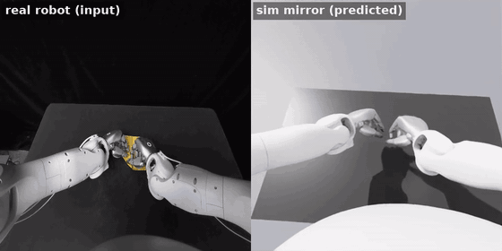
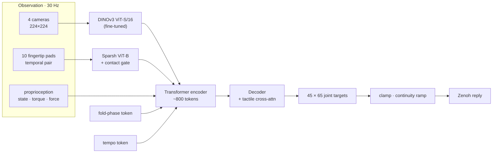

<div align="center">

# FoldingACT

### Teaching two dexterous robot hands to fold a paper airplane

**[Robotic Origami Challenge](https://robotic-origami-challenge.github.io/) · IROS 2026**

[](https://ismael-esp.github.io/robotic-origami-challenge/)
[](docs/getting_started.md)
[](docs/getting_started.md)
[](docs/getting_started.md)

[**Project page**](https://ismael-esp.github.io/robotic-origami-challenge/) · [**Results**](docs/RESULTS.md) · [**Getting started**](docs/getting_started.md) · [**Challenge spec**](docs/challenge_spec.md)

<br>



<sub>Left: a held-out teleoperated demonstration. Right: the robot in Isaac Sim executing FoldingACT's predicted joint targets.</sub>

</div>

<br>

FoldingACT is an end-to-end visuomotor imitation policy for a bimanual robot with two
22-joint Sharpa hands. The task: fold a paper airplane in six folds, in under ten minutes,
from four cameras, ten fingertip tactile sensors and 65 joints of proprioception. I built the
full stack:
- the data pipeline for a 398 GB LeRobot v3 dataset;
- a multimodal action-chunking transformer;
- ten trained and gated model versions;
- an Isaac Sim motion mirror;
- a hardened Docker / Zenoh inference service that the organizers ran on their real robot.

**👉 The full write-up, with videos and interactive charts, is on the [project page](https://ismael-esp.github.io/robotic-origami-challenge/).**

## Highlights

- **Vision and touch fused in one transformer.** Fine-tuned DINOv3 encoders for the cameras
  and a Sparsh encoder for the fingertips feed one ACT-style CVAE. It predicts 1.5 s chunks of
  65-D joint targets.
- **Ten versions, each gated before shipping.** Serve-matched training cut live-server replay
  error from 0.0254 rad (v4) to 0.0159 rad (v6/v7). The best Isaac Sim mirror error is
  0.0100 rad.
- **Safety-checker compliant.** A per-joint clamp and a first-step continuity ramp took the
  organizers' URDF "Shadow" check from 308 violations to 0.
- **An honest real-robot failure, root-caused.** In two live sessions the v9 policy completed
  no fold. Log analysis showed causal confusion: the policy followed its own joint state in
  94 % of state/vision conflicts, so finger errors integrated until the hands locked. The
  final v10 breaks that shortcut, with vision winning 97 % of conflicts and closed-loop drift
  down 28–34 %. v10 has not been run on hardware.

## Results at a glance

| | v4 | v6 / v7 | v9 | v10 (final) |
|---|---|---|---|---|
| Live-server replay error (rad) | 0.0254 | **0.0159** | — | — |
| Isaac Sim mirror error (rad) | 0.0149 | **0.0100** (v6) | — | — |
| Vision wins state/image conflicts | — | 12 % (v7) | 6 % | **97 %** |
| Closed-loop drift, async (rad, 30 s) | — | — | 0.0337 | **0.0224** |
| Real robot | — | — | 0 folds, 2 sessions | not tested |

See [`docs/RESULTS.md`](docs/RESULTS.md) for every gate, the simulation results and the
live-session analysis.

## Architecture



## Repository layout

```
policy/
  model/      FoldingACT, v3 decoder with tactile cross-attention, StageNet
  data/       LeRobot v3 → LMDB loaders, fold auto-labelling, retiming, normalization
  serve/      Zenoh policy service, FoldTracker, replay and transport tests
  sim/        Isaac Sim mirror, joint-order mapping
  train_full.py, eval_*.py   training (DDP, serve-matched) and the gate battery
scripts/      dataset download / predecode, clamp-bound fitting, submission builder
docs/         project page (index.html), RESULTS.md, getting_started.md, data notes
outputs/      evaluation JSONs, normalization stats, fold labels (checkpoints not tracked)
```

The dataset is gated on Hugging Face (`SharpaIT/Robotic_Origami_Challenge`). The organizers'
inference kit and robot description files are not redistributed here.
[`docs/getting_started.md`](docs/getting_started.md) covers access, preprocessing, training,
evaluation and serving.

## Author

**Ismael Espinoza**. Robot, dataset and live evaluation were provided by the IROS 2026
Robotic Origami Challenge organizers.

---

Developed in 2026 by Ismael Espinoza Jaramillo (PhD candidate, Kyung Hee University) in the lab's private workspace and published here as a clean snapshot in Oct 2026 · [ismael-esp.github.io](https://ismael-esp.github.io) · [github.com/ismael-esp](https://github.com/ismael-esp)
